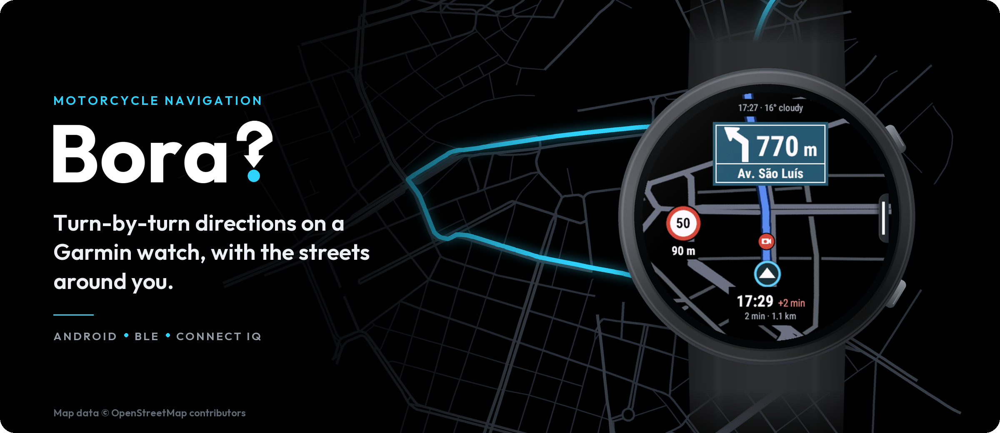
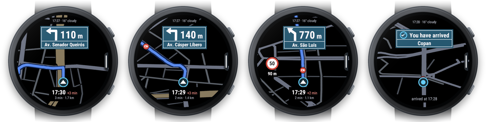
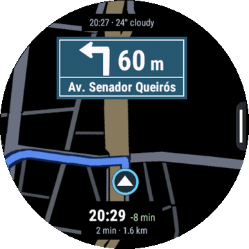
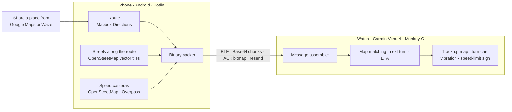

<p align="center">
  
</p>

<p align="center">
  
  
  
  
  
  
</p>

<p align="center">
  
</p>
<p align="center"><sub>Screens from the Connect IQ simulator (watch v1.2.9) on a real route in downtown São Paulo, from a preview build with the on-screen text in English (<code>tools/telas_en.py</code>). The watch frame and the map above are drawn by <code>tools/moldura.py</code>. Map data © OpenStreetMap contributors.</sub></p>

Bora? is two apps that work as one. An Android companion computes the route and downloads the streets
around it; a Connect IQ app on a **Garmin Venu 4 (45 mm)** draws them as a moving map that turns with you
(track-up), with the next turn. It is a personal project, built for my own rides, and it is not on any store.

**[Install it →](INSTALL.md)** The APK and the watch app are on the
[releases page](https://github.com/IgorLima-py/bora-nav/releases/latest); setup takes about 15 minutes.

<p align="center">
  
</p>
<p align="center"><sub>The last 1.6 km of the virtual ride in the same simulator and English preview build, ridden at real speed and played 14× faster (<code>tools/gif_simulador.py</code>). Map data © OpenStreetMap contributors.</sub></p>

## Why

On a motorcycle you look at your wrist for about one second, with gloves on and the phone in your
pocket. The navigation that reaches a Garmin watch today gives you an arrow and the line of the route.
I wanted to see the street: the corner I have to take, and the ones around it, so I can tell which
one is mine at a glance.

## How it works



| | Phone (Android, Kotlin) | Watch (Venu 4 45 mm, Monkey C) |
|---|---|---|
| **Route** | asks Mapbox Directions, recomputes it when you leave it | follows it, detects when you are off-route and asks for a new one |
| **Streets** | downloads OpenStreetMap vector tiles along the route, simplifies and packs them by road class | draws them in world-anchored tiles, rotated with your heading |
| **Position** | its GPS is the fallback when the watch has no fix | asks for 1 Hz GPS, multiband when available, matched to the route |
| **Turns** | parses the maneuvers and street names | turn card with the distance, and an optional vibration before the turn |
| **Speed cameras** | finds them in OpenStreetMap near the route | shows the speed-limit sign and can vibrate once per camera |
| **Protocol** | Kotlin packer, mirror of `tools/packer.py` | Monkey C assembler, checked against the same fixtures |

## Engineering highlights

- **Share to wrist in 7.05 s.** From tapping "Share" on the phone to the full route on the watch: a
  15.2 km route, 585 points and 18 maneuvers in 3 blocks (2,827 B), every block acknowledged. The target
  was 10 s. Bluetooth cost is per message, not per byte: a 37 B block took 747 ms and a 2,352 B block
  1,249 ms. A later share on the road took 3.9 s.
- **One protocol, three languages, checked byte by byte.** 17 message types in 4,096-byte chunks,
  specified in [`docs/05-PROTOCOL.md`](docs/05-PROTOCOL.md). `tools/packer.py` is the reference: the Kotlin
  packer and the Monkey C assembler are tested against the binary fixtures it generates, so a change that
  misses one side fails a test instead of failing on the road. Frames travel as Base64 in a string both
  ways, because neither SDK delivers a raw byte array (+33% on air).
- **Living inside the watchdog.** Connect IQ kills an app when one callback runs too long (the
  simulator's Venu 4 profile allows 240,000 instructions). Every frame counts its own work in points
  (about 0.19 ms each on the watch; the frame that killed the app cost about 3,000). An adaptive leash
  shrinks or grows how much of the street corridor gets drawn, so the route itself is never cut, and the
  tests fail above 2,000 points. The simulator enforces the watchdog in a normal run, so what dies there
  would have died on the wrist.
- **A quadratic `add`.** The app died while receiving streets. In Monkey C, `add` copies the whole array,
  so building a 1,500-point corridor point by point meant about 1.1 million element copies against a
  240,000-instruction budget. It only showed up once real neighborhood streets started arriving. With a
  pre-sized array, four times the corridor costs 4.9× instead of 16×, and parsing now runs in slices of
  450 points on a timer.
- **218 tests in the watch simulator and 319 on the JVM**, all green on 2026-10-28, plus a virtual ride
  that drives the whole São Paulo route through the same entry point as the GPS and checks every turn
  alert against the rule.
- **Seven attempts on the street before the transfer worked**, each stopped by a different cause that
  only showed up on hardware. One of them sent me to Bosnia: a share with only a link geocoded the
  literal label `"Destino"`, which resolved to a random place.

## What works today

Ridden with the app: at least **223.5 km** in October 2026, measured by the app's own track (58.6 km on
2026-10-16, 31.1 km on 10-19, 46.1 km on 10-20, 33.2 km on 10-23 and 54.5 km on 10-26).

- **Share to route:** share a place from Google Maps on the phone and the route reaches the watch
  (7.05 s in the first test, 3.9 s on the 2026-10-20 ride).
- **Favorites from the wrist:** picking a favorite on the watch brings a full route in 2.6 to 10.9 s.
- **Rerouting:** on the 2026-10-19 ride it recomputed the route 4 times after I left it.
- **English and Portuguese:** both apps follow the device's language, and the phone app has a
  first-time setup that walks you through the Mapbox token, the permissions and the watch.
- **Speed cameras:** on the 2026-10-26 ride the Overpass servers answered 16 of 17 camera lookups (14
  routes had cameras, 2 had none), and the watch vibrated for a camera 17 times, up to about 360 m ahead.
- **Streets on the map:** all four road classes reach the watch on every route, with 20 to 110 streets on
  screen, on a track-up map whose rotation was fixed and confirmed on the street.
- **Stable on a long ride:** 0 crashes in 7,934 s on 2026-10-19, peak memory 220 of 763 KB, and 2.3 to
  3.9 % of watch battery per hour with the app open.
- **End to end on a PC:** phone app in the Android emulator, watch app in the Connect IQ simulator
  (`tools/e2e.py`), plus a virtual ride of a 22.4 km São Paulo route that checks every turn alert.

## Not yet field-tested

- **One hour with the screen on.** The battery numbers above come from rides; the dedicated one-hour
  test has not been done.
- **Bluetooth dropping mid-transfer.** Resending lost blocks has unit tests and an emulator test, and has
  never run on the devices.

## Known issues

- **The adaptive leash is stuck at its floor (220 points).** On 2026-10-23 it never left the minimum, so
  the "street by street" drawing mode drew almost nothing, and the default map stays empty for a few
  seconds while its tiles build. Frames took 158 to 208 ms; the suspect is a 130 ms frame cap that shrinks
  the corridor whatever made the frame slow. The 2026-10-26 ride, on watch v1.2.9, was the same: the
  leash sat at 220 in 306 of 307 frame summaries.
- **Speed cameras depend on public Overpass servers**, which refuse requests under load. On 2026-10-23
  they refused both attempts (502 and 504). On 2026-10-26 one of 17 lookups failed after both attempts,
  and 5 others needed the second attempt. Retrying with backoff and caching cameras per region are next.
- **The turn vibration doesn't come through gloves.** It became a phone setting on 2026-10-22, off by
  default, and was on for the 2026-10-26 ride: 81 turn alerts, the first at about 70 to 110 m and the
  second at 15 to 25 m. I did not feel them through my gloves.
- **Rerouting once put me on a motorway.** The fix (`exclude=motorway` in the Mapbox request) is in the
  code and has not been ridden yet.
- **One watch.** Only the Venu 4 45 mm is supported, sideloaded, with no settings through Garmin
  Connect.

## How it was built with AI

Most of the code was written with Claude Code, one slice at a time, from 2026-07-29 to today. The
process lives in working files, in Portuguese, that stay out of this public copy:

- a rules file every session loads: the protocol is a contract for all three languages, nothing goes to
  the watch without the simulator suite green, ask for the crash log before any theory, measure before
  giving an opinion;
- a roadmap with the queue of slices (one chat per slice, in order), and a hand-off each session writes
  for the next one, including what was tried and failed;
- a decisions log with every decision taken outside the spec, with the rejected alternative, and every
  hardware measurement: 137 dated entries so far.

## Build

You need the Connect IQ SDK with the `venu445mm` device, a Connect IQ developer key, Python 3.11+,
and JDK 21 with the Android SDK for the companion. Each user brings their own Mapbox token, typed into
the phone app.

```bash
python3 tools/sim.py all                                   # watch: simulator tests + debug and release builds
cd companion && ./gradlew assembleDebug testDebugUnitTest  # phone: APK + JVM tests
python3 tools/package.py --keystore your.keystore --alias your_alias   # release files in dist/
```

```
watch/       Connect IQ app (Monkey C) for the venu445mm, with its simulator tests
companion/   Android app (Kotlin, Compose), package dev.igor.motonav
tools/       protocol reference (packer.py), fixtures, simulator runner and helpers
docs/        the protocol spec, the README images and the watch screen tokens
```

`tools/packer.py` is the reference for the binary protocol: after any change to
[`docs/05-PROTOCOL.md`](docs/05-PROTOCOL.md), regenerate the fixtures with it and
`tools/gen_watch_test_vectors.py`, and both apps' tests check themselves against them. Other tools:
`sideload.ps1` copies the watch app over USB (Windows), `decode_ciq_log.py` turns the watch's crash log
into file and line, `relatorio.py` summarizes a ride log, and `preview_map.py` draws the frame the watch
would draw, with its cost. The apps' log lines and some tool output are still in Portuguese, because the
tools parse them.

## License and third-party data

The code is under the [MIT License](LICENSE). Third-party code, fonts and data are listed in
[`NOTICE`](NOTICE):

- Streets and speed cameras: © OpenStreetMap contributors, under the ODbL. Street tiles from VersaTiles,
  whose tileset includes ESA WorldCover land cover (© ESA WorldCover project 2021, Copernicus Sentinel data).
- Official speed cameras missing from OpenStreetMap: [pardal](https://github.com/Murkiriel/pardal) (ODbL),
  which merges OpenStreetMap with official lists (CET-SP (CC BY), ANTT (CC BY), DER-SP, DNIT, Inmetro, PRF, city halls
  and others, each with its license in the `NOTICE`).
- Test routes recorded from OSRM (routing.openstreetmap.de, by FOSSGIS), OpenStreetMap data.
- Directions powered by Mapbox. Each user brings their own Mapbox token and is responsible for following
  the Mapbox Terms of Service.

This is an independent project, not affiliated with or endorsed by Garmin. Garmin, Venu and Connect IQ
are trademarks of Garmin Ltd. or its subsidiaries.
